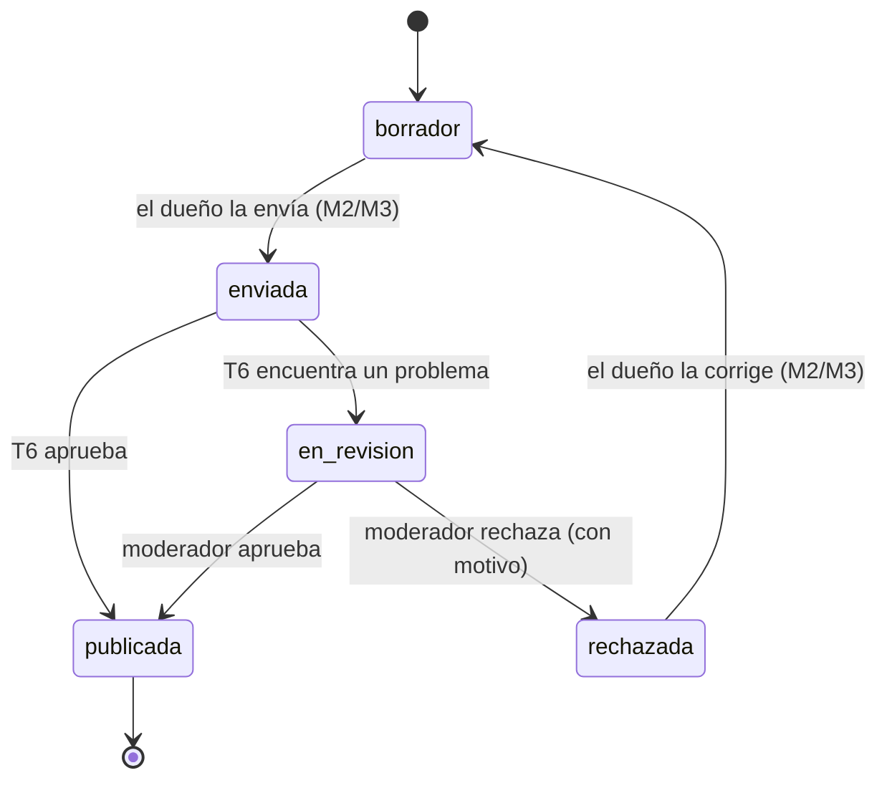

# Contrato del M4 · Panel y moderación · v1.0 (T61)

> Ticket: `GAMMA-M4-001 · LID-13 · Contrato del M4` · Autor: Sebas · Fecha: 16/11/2026
> Valida: Ivo (P2) · Ubicación: `docs/gamma/contratos/contrato-m4.md`
> Se apoya en: contrato del M1 v1.0 (`usuario_actual`, `tiene_rol`), matriz de permisos v1.0 (filas M4-01 a M4-10), PRD-14, ADR 0004.

## 1. Propósito

Define qué ofrece el M4 para que **nada se publique sin el OK de al menos un moderador** (PRD-14):
- recibe el resultado del moderador automático **T6**;
- ofrece la **cola *en revisión*** (P42) donde un moderador aprueba o rechaza con motivo;
- recibe **reportes** del admin nivel 2;
- muestra el **panel con métricas** (P40);
- registra cada cambio en el **historial T58**.

## 2. Alcance

| Incluye | No incluye |
|---|---|
| La máquina de estados de moderación de ofertas y búsquedas | Crear o editar ofertas y búsquedas: M2 y M3 |
| La cola *en revisión* y las decisiones humanas | La moderación automática: T6, de DevSecOps |
| Los reportes del nivel 2 | El historial en sí: T58, de DevSecOps (el M4 lo usa) |
| Las métricas del panel | Dar de baja y restaurar: el M4 llama a las funciones que M2 y M3 ofrecen |

## 3. Máquina de estados

| Desde | Hacia | Quién | Función |
|---|---|---|---|
| `borrador` | `enviada` | Dueño | M2 / M3 (no es del M4) |
| `enviada` | `publicada` | T6 | G1 |
| `enviada` | `en_revision` | T6 | G1 |
| `en_revision` | `publicada` | `moderador` o `admin_n1` | G3 |
| `en_revision` | `rechazada` | `moderador` o `admin_n1`, **con motivo** | G3 |
| `rechazada` | `borrador` | Dueño | M2 / M3 (no es del M4) |

**Cualquier otra transición es inválida.** En particular: nadie pasa de `borrador` o `enviada` a `publicada` a mano, y una publicación `publicada` o `rechazada` no se vuelve a decidir.

## 4. Tipos

| Tipo | Definición |
|---|---|
| `Estado` | Enumeración: `borrador`, `enviada`, `en_revision`, `publicada`, `rechazada` |
| `TipoPublicacion` | Enumeración: `oferta`, `busqueda` |
| `RefPublicacion` | `(tipo: TipoPublicacion, id: str)` — identifica una oferta o búsqueda sin depender de las tablas de M2 y M3 |
| `ResultadoT6` | `aprobado: bool`, `motivos: list[str]` (vacía si `aprobado`) |
| `Decision` | Enumeración: `aprobar`, `rechazar` |
| `ItemCola` | `ref`, `titulo`, `grupo_id`, `motivos_t6`, `reportes: int`, `en_revision_desde` |
| `Reporte` | `id`, `ref`, `autor_id`, `motivo`, `creado_en` |
| `Metricas` | `enviadas`, `en_revision`, `publicadas`, `rechazadas`, `reportes_abiertos`, `tiempo_medio_revision_horas` |

Ningún tipo incluye correo, contraseña ni datos del perfil del dueño. El dueño se identifica solo con su `id`.

## 5. Funciones

### G1 · `recibir_resultado_t6(ref: RefPublicacion, resultado: ResultadoT6) -> Estado`

La llama **solo el sistema (T6)**, nunca un usuario (matriz M4-09).
- La publicación tiene que estar en `enviada`; si no → `TransicionInvalida`.
- `aprobado = True` → pasa a `publicada`.
- `aprobado = False` → pasa a `en_revision` y guarda los motivos de T6.

### G2 · `listar_cola_revision(sesion_id: str) -> list[ItemCola]`

La cola de P42 (matriz M4-01, M4-03).
- Solo `moderador` o `admin_n1`; si no → `PermisoDenegado`.
- Devuelve las publicaciones en `en_revision`, de la más vieja a la más nueva.
- **No incluye las publicaciones propias** de quien consulta (supuesto S6 de la matriz).

### G3 · `decidir(sesion_id: str, ref: RefPublicacion, decision: Decision, motivo: str | None) -> Estado`

Aprobar o rechazar (matriz M4-02, M4-03).
- Solo `moderador` o `admin_n1`; si no → `PermisoDenegado`.
- No sobre una publicación propia → `PermisoDenegado`.
- Solo desde `en_revision`; si no → `TransicionInvalida`.
- `rechazar` exige un motivo no vacío (máximo 300 palabras, PRD-NF9); si falta → `MotivoRequerido`.
- `aprobar` → `publicada`; `rechazar` → `rechazada`. El motivo queda visible para el dueño.

### G4 · `reportar(sesion_id: str, ref: RefPublicacion, motivo: str) -> Reporte`

Reporte del nivel 2 (matriz M4-06, M4-07).
- Solo `admin_n2` y solo sobre publicaciones de su grupo; si no → `PermisoDenegado`.
- Exige motivo no vacío → si falta, `MotivoRequerido`.
- **No cambia el estado:** el reporte aparece en la cola como contador (`ItemCola.reportes`) o, si la publicación está `publicada`, en la lista de reportes abiertos del panel. Lo decide un moderador.

### G5 · `metricas_panel(sesion_id: str) -> Metricas`

Panel P40 (matriz M4-04, M4-05).
- `admin_n1` → métricas de todo el sistema.
- `admin_n2` → métricas solo de su grupo.
- Cualquier otro rol → `PermisoDenegado`.

### G6 · Baja y restauración (uso de M2 y M3)

El M4 **no da de baja publicaciones por su cuenta**: desde el panel, el `admin_n1` usa las funciones de baja y restauración que M2 y M3 ofrecen al admin (matriz M2-05, M3-05). Mientras no existan, se usan los simulados (`GAMMA_SIMULADOS=1`).

### Historial T58

**Cada cambio de estado (G1, G3) y cada reporte (G4) se registra en T58** con: quién (id o "T6"), qué publicación, estado anterior, estado nuevo, motivo y fecha. El M4 llama a la función de registro de T58; **si el registro falla, el cambio no se aplica** (todo o nada).

## 6. Casos

Cada fila es al menos un test (VA2).

### G1 · `recibir_resultado_t6`

| # | Dado | Cuando | Entonces |
|---|---|---|---|
| G1-01 | Oferta `enviada` | T6 manda `aprobado = True` | Pasa a `publicada`; queda en T58 |
| G1-02 | Oferta `enviada` | T6 manda `aprobado = False` con motivos | Pasa a `en_revision` con los motivos; queda en T58 |
| G1-03 | Búsqueda `borrador` | T6 manda un resultado | `TransicionInvalida`; nada cambia |
| G1-04 | Oferta `publicada` | T6 manda un resultado | `TransicionInvalida`; nada cambia |
| G1-05 | Oferta `enviada`, T58 falla | T6 manda `aprobado = True` | Error; la oferta sigue `enviada` |

### G2 · `listar_cola_revision`

| # | Dado | Cuando | Entonces |
|---|---|---|---|
| G2-01 | Moderador; 3 publicaciones `en_revision` | Pide la cola | Las 3, de la más vieja a la más nueva |
| G2-02 | `admin_n1` | Pide la cola | La cola completa |
| G2-03 | `admin_n2` | Pide la cola | `PermisoDenegado` |
| G2-04 | Talento | Pide la cola | `PermisoDenegado` |
| G2-05 | Moderador que es dueño de una publicación `en_revision` | Pide la cola | Esa publicación no aparece |
| G2-06 | Ninguna publicación `en_revision` | Pide la cola | Lista vacía |

### G3 · `decidir`

| # | Dado | Cuando | Entonces |
|---|---|---|---|
| G3-01 | Moderador; oferta `en_revision` | `aprobar` | `publicada`; queda en T58 con el id del moderador |
| G3-02 | Moderador; oferta `en_revision` | `rechazar` con motivo | `rechazada`; motivo guardado y en T58 |
| G3-03 | Moderador; oferta `en_revision` | `rechazar` sin motivo | `MotivoRequerido`; nada cambia |
| G3-04 | Moderador; oferta `publicada` | `rechazar` con motivo | `TransicionInvalida` |
| G3-05 | `admin_n2`; oferta de su grupo `en_revision` | `aprobar` | `PermisoDenegado` |
| G3-06 | Moderador dueño de la publicación | `aprobar` | `PermisoDenegado` |
| G3-07 | `admin_n1`; búsqueda `en_revision` | `aprobar` | `publicada` (último recurso) |
| G3-08 | Motivo de más de 300 palabras | `rechazar` | `MotivoRequerido` (inválido) |

### G4 · `reportar`

| # | Dado | Cuando | Entonces |
|---|---|---|---|
| G4-01 | `admin_n2`; oferta `publicada` de su grupo | Reporta con motivo | Se crea el `Reporte`; el estado no cambia; queda en T58 |
| G4-02 | `admin_n2`; oferta de otro grupo | Reporta | `PermisoDenegado` |
| G4-03 | Moderador | Reporta | `PermisoDenegado` |
| G4-04 | `admin_n2`; motivo vacío | Reporta | `MotivoRequerido` |
| G4-05 | `admin_n2`; oferta `en_revision` reportada dos veces | Moderador pide la cola | `ItemCola.reportes = 2` |

### G5 · `metricas_panel`

| # | Dado | Cuando | Entonces |
|---|---|---|---|
| G5-01 | `admin_n1` | Pide métricas | Totales de todo el sistema |
| G5-02 | `admin_n2` del grupo A | Pide métricas | Solo cuenta publicaciones del grupo A |
| G5-03 | Moderador | Pide métricas | `PermisoDenegado` |
| G5-04 | Sin publicaciones | `admin_n1` pide métricas | Todo en cero; `tiempo_medio_revision_horas = 0` |

## 7. Errores

| Error | Cuándo |
|---|---|
| `SesionInvalida` | Viene del M1 (`usuario_actual`) |
| `PermisoDenegado` | El rol no puede hacer la acción, o es sobre algo propio o de otro grupo |
| `PublicacionNoEncontrada` | La referencia no existe o está dada de baja |
| `TransicionInvalida` | La transición no está en la tabla de la §3 |
| `MotivoRequerido` | Falta el motivo o supera las 300 palabras |

Todos heredan de `ErrorM4`.

## 8. Simulados

Con `GAMMA_SIMULADOS=1`: ofertas y búsquedas de ejemplo en memoria (M2 y M3), un T6 falso que aprueba o manda a revisión según un marcador del título, y un T58 en memoria que se puede inspeccionar en los tests. **Cumplen estos mismos casos.**

## 9. Decisiones

| # | Pregunta | Decisión |
|---|---|---|
| 9.1 | ¿Un reporte cambia el estado? | **No.** Solo lo marca para el moderador. El nivel 2 reporta, no modera |
| 9.2 | ¿Se puede volver a decidir algo `publicada` o `rechazada`? | **No** desde el M4. Una publicación rechazada vuelve a `borrador` por M2/M3 y se envía de nuevo |
| 9.3 | ¿El moderador modera lo propio? | **No** (supuesto S6 de la matriz) |
| 9.4 | ¿El M4 da de baja publicaciones? | **No:** usa las funciones de M2 y M3 |
| 9.5 | ¿Qué pasa si T58 falla? | El cambio no se aplica: todo o nada |
| 9.6 | ¿Un reporte sobre algo `publicada` la saca de publicación? | **No** en v1.0; queda en la lista de reportes abiertos del panel. *(A confirmar con Hugo.)* |

## 10. Cambios

| Versión | Fecha | Cambio |
|---|---|---|
| 1.0 | 16/11/2026 | Máquina de estados, G1 a G5, uso de M2/M3 y T58, casos y decisiones |
